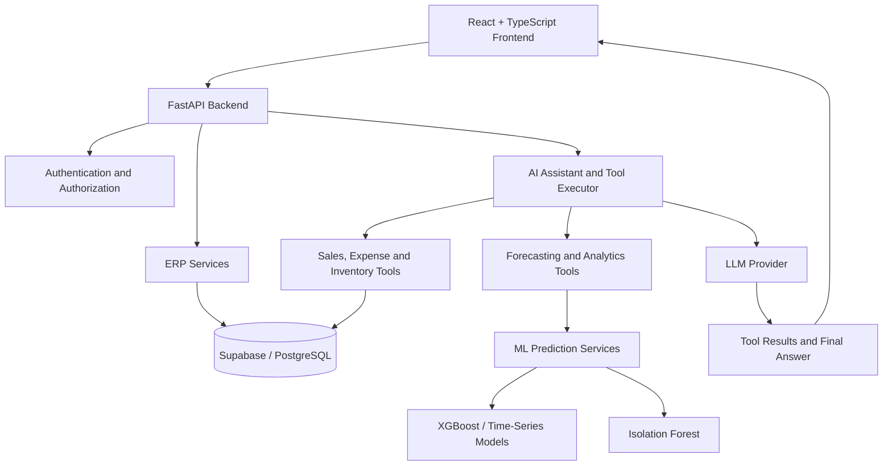

# ALLADIN — AI-Powered Financial Intelligence Platform

**From business data to intelligent decisions.**

ALLADIN (AI-powered Ledger Learning and Analytics for Decision Intelligence Network) is an AI-enabled financial intelligence and ERP platform designed to help Micro, Small, and Medium Enterprises (MSMEs) understand their financial and operational data through machine learning, forecasting, anomaly detection, and conversational AI.

The platform combines core ERP workflows with predictive analytics and an AI business assistant to make financial insights more accessible and actionable.

**GitHub Repository:** [ai-financial-intelligence-platform](https://github.com/SooryaBhat/ai-financial-intelligence-platform)

---

## Table of Contents

- [Overview](#overview)
- [Problem Statement](#problem-statement)
- [Key Features](#key-features)
- [System Architecture](#system-architecture)
- [Machine Learning and Analytics](#machine-learning-and-analytics)
- [AI Business Assistant](#ai-business-assistant)
- [Technology Stack](#technology-stack)
- [Project Structure](#project-structure)
- [Getting Started](#getting-started)
- [Environment Configuration](#environment-configuration)
- [Running the Application](#running-the-application)
- [Example Use Cases](#example-use-cases)
- [Security and Data Isolation](#security-and-data-isolation)
- [Dataset and Evaluation](#dataset-and-evaluation)
- [Current Limitations](#current-limitations)
- [Future Enhancements](#future-enhancements)
- [Contributing](#contributing)
- [License](#license)

---

## Overview

Small and medium-sized businesses generate data across sales, purchases, inventory, expenses, invoicing, and payments. However, turning these records into useful financial insights often requires manual analysis, spreadsheet calculations, and knowledge of data analytics.

ALLADIN aims to bridge this gap by integrating ERP operations, machine learning, and conversational AI into one platform.

The system is designed to:

- Centralize financial and operational records.
- Forecast revenue and identify business trends.
- Detect unusual financial transactions.
- Monitor inventory levels and potential stock shortages.
- Calculate business performance indicators.
- Allow users to ask business questions in natural language.
- Retrieve relevant business information through an AI assistant.

The long-term goal is to provide a modular financial intelligence platform that combines structured ERP data, predictive models, business-document retrieval, and open-weight language models.

## Problem Statement

Traditional business management systems primarily focus on recording transactions and displaying historical reports. Business owners may still need to manually interpret financial patterns, identify unusual activity, estimate future revenue, and determine which operational issues require attention.

ALLADIN addresses these challenges through an integrated approach:

| Business challenge | ALLADIN approach |
|---|---|
| Financial information spread across different workflows | Centralized ERP and financial data management |
| Limited visibility into future revenue | Time-series forecasting and predictive analytics |
| Difficulty identifying unusual transactions | Machine-learning-based anomaly detection |
| Inventory shortages and excess stock | Inventory monitoring and demand-analysis pipelines |
| Manual calculation of business KPIs | Automated business health and financial indicators |
| Complex reports requiring manual interpretation | Natural-language AI assistant and tool calling |
| Business information distributed across documents | Planned retrieval-augmented generation (RAG) |

## Key Features

### 1. ERP and Financial Management

- Sales and transaction analysis.
- Expense tracking and category-wise summaries.
- Product and inventory information.
- Stock-level monitoring and stock movement workflows.
- Invoicing and related business records.
- Company-specific financial and operational data.

### 2. Predictive Analytics

- Revenue forecasting using machine learning and time-series methods.
- Sales and demand analysis.
- Inventory-related prediction and monitoring.
- Expense and profit analysis.
- Business health assessment.
- Unusual transaction detection.

### 3. AI Business Assistant

The assistant is designed to connect natural-language questions with controlled backend tools.

Instead of asking users to navigate multiple reports, the assistant can select an appropriate tool, retrieve the relevant business information, and explain the result in natural language.

### 4. Multi-Tenant Architecture

The platform is designed to support multiple companies, with company-specific business records and server-side authorization to prevent unauthorized access across tenants.

### 5. Modular AI Architecture

The application separates the ERP data layer, prediction services, and AI assistant so that language-model providers and retrieval components can be developed independently.

---

## System Architecture

The following diagram describes the intended high-level architecture.



### Architecture components

- **Frontend:** Provides the user interface for ERP operations, analytics, and conversational interaction.
- **FastAPI backend:** Handles API requests, business logic, authentication, and integration with analytics services.
- **Supabase/PostgreSQL:** Stores structured business records and supports company-specific data access.
- **ML services:** Generate forecasts and anomaly scores using existing model pipelines.
- **AI tool executor:** Maps supported assistant requests to validated backend functions.
- **LLM integration:** Interprets user questions, selects tools, and generates responses from tool results.

Document retrieval and an open-weight LLM provider are intended extensions of this architecture and should be enabled only after their integrations are implemented and tested.

## Machine Learning and Analytics

ALLADIN includes predictive and analytical pipelines intended to support business decision-making.

| Area | Approach | Purpose |
|---|---|---|
| Revenue forecasting | XGBoost and time-series forecasting methods | Estimate future revenue from historical observations |
| Sales analysis | Historical sales aggregation and prediction pipelines | Identify sales trends and product-level patterns |
| Inventory analysis | Stock-level and demand-related logic | Identify low stock and potential replenishment needs |
| Expense analysis | Financial aggregation and analytical pipelines | Understand spending patterns |
| Profit analysis | Financial calculations and prediction pipeline | Examine profitability trends |
| Business health | KPI-based scoring and business rules | Summarize financial and operational indicators |
| Anomaly detection | Isolation Forest | Flag unusual transactions for investigation |

The platform includes seven predictive and analytical pipeline areas. These do not necessarily represent seven independently trained machine learning models: some components use rules or calculated KPIs rather than a trained model.

### Forecasting workflow

1. Retrieve the relevant historical business records.
2. Prepare and aggregate data into the format required by the selected model.
3. Generate predictions using the available forecasting pipeline.
4. Return the prediction through a FastAPI endpoint.
5. Present the result to the user or AI assistant.

Forecasting quality depends on data coverage, seasonality, historical consistency, and the validation method. Predictions should be treated as estimates rather than guaranteed business outcomes.

### Anomaly detection

The anomaly detection pipeline uses Isolation Forest to identify observations that differ from learned transaction patterns.

An anomaly is an indication that a transaction may deserve further investigation. It does not, by itself, prove fraud or wrongdoing.

---

## AI Business Assistant

The AI assistant connects natural-language interaction with backend ERP and analytical functions.

### Tool-calling capabilities

The current tool-calling implementation defines six business tools:

| Tool | Purpose |
|---|---|
| `get_sales_analysis` | Retrieve sales summaries, transaction counts, and product analysis |
| `get_expense_summary` | Summarize expenses and spending categories |
| `get_inventory_status` | Inspect inventory and identify low-stock products |
| `forecast_revenue` | Invoke the available revenue forecasting pipeline |
| `detect_transaction_anomalies` | Evaluate transactions for unusual patterns |
| `get_business_health_analysis` | Calculate business health indicators from available ERP data |

### How tool calling works

1. A user asks a question in the chat interface.
2. The language model interprets the request and selects an available tool.
3. The backend validates the tool arguments and executes the authorized function.
4. The tool retrieves relevant ERP data or invokes an analytical service.
5. The tool result is returned to the language model.
6. The assistant generates a natural-language response grounded in the returned information.

The language model should not directly access database credentials or execute arbitrary SQL. Database access remains the responsibility of the backend.

### Retrieval-Augmented Generation (RAG)

RAG is a planned extension for grounding responses in relevant business documents, policies, and domain-specific guidance.

The intended workflow is:

1. Ingest authorized business documents.
2. Split documents into searchable passages.
3. Generate embeddings and store them in a retrieval index.
4. Retrieve relevant passages for a user query.
5. Provide the retrieved context to the language model.
6. Generate an answer grounded in that context.

RAG is intended to complement tool calling, not replace it. Document retrieval is appropriate for policy and explanatory questions, while tools are needed for current numerical information such as sales totals, expenses, and inventory balances.

### Open-weight language models

The planned language-model architecture supports local experimentation with Ollama and open-weight models. Qwen3 4B has been installed and tested separately with Ollama, but the ALLADIN provider integration and complete RAG workflow must be verified before they are described as fully operational.

---

## Technology Stack

| Category | Technologies |
|---|---|
| Frontend | React, TypeScript, Vite |
| Backend | Python, FastAPI |
| Database | PostgreSQL, Supabase |
| Machine Learning | XGBoost, Prophet, Isolation Forest |
| AI integration | LLM function calling, backend tool execution |
| Local model experimentation | Ollama, Qwen3 4B |
| API communication | REST APIs |
| Development tools | Git, GitHub, VS Code / Antigravity |

The availability of individual forecasting algorithms and language-model integrations depends on the corresponding implementation and configuration in the repository.

---

## Project Structure

The following is a conceptual overview. Actual filenames may differ depending on the current repository structure.

```text
ai-financial-intelligence-platform/
├── backend/
│   ├── app/
│   │   ├── api/
│   │   │   └── v1/
│   │   │       └── chat.py
│   │   ├── services/
│   │   │   ├── ai_assistant.py
│   │   │   ├── ai_tools.py
│   │   │   └── ai_context_service.py
│   │   ├── ml/
│   │   │   ├── model_loader.py
│   │   │   ├── revenue_predictor.py
│   │   │   ├── anomaly_detector.py
│   │   │   └── business_health.py
│   │   └── main.py
│   └── tests/
├── frontend/
│   └── src/
│       ├── components/
│       ├── pages/
│       └── services/
├── README.md
└── .gitignore
```

This tree illustrates important components reported in the implementation. It is not a complete inventory of every file in the repository.

---

## Getting Started

### Prerequisites

Install the following tools before setting up the project:

- Python 3.10 or a version supported by the backend dependencies.
- Node.js and npm.
- Git.
- A configured Supabase project with the required database schema.
- Required backend environment variables.
- An available language-model provider if you want to use the AI assistant.

For local LLM experimentation, install [Ollama](https://ollama.com/).

### 1. Clone the repository

```bash
git clone https://github.com/SooryaBhat/ai-financial-intelligence-platform.git
cd ai-financial-intelligence-platform
```

### 2. Configure the backend

```bash
cd backend
python -m venv venv
```

Activate the virtual environment on Windows:

```powershell
.\venv\Scripts\Activate.ps1
```

Install the dependencies:

```bash
pip install -r requirements.txt
```

Create the backend environment file using the project's actual configuration requirements. Never commit real credentials.

### 3. Configure the frontend

Open a second terminal:

```bash
cd frontend
npm install
```

Configure the frontend environment variables according to the existing Vite configuration. Use only the public values intended for browser access; never expose a Supabase service-role key in frontend code.

### 4. Configure Supabase

1. Create or select a Supabase project.
2. Configure the required PostgreSQL schema and tables.
3. Apply the project's schema and security policies, where provided.
4. Configure authentication and company-level access.
5. Load authorized development or synthetic data if available.

The database schema and seed-data setup must match the actual SQL files and migrations in the repository.

---

## Environment Configuration

Create a local `.env` file in the appropriate backend directory and provide the values required by the application.

Example configuration template:

```dotenv
SUPABASE_URL=your_supabase_project_url
SUPABASE_ANON_KEY=your_supabase_anon_key
SUPABASE_SERVICE_ROLE_KEY=your_server_only_service_role_key
JWT_SECRET=your_jwt_secret

# Configure only if required by the active provider
GEMINI_API_KEY=your_api_key

# Local Ollama configuration for supported integrations
OLLAMA_BASE_URL=http://localhost:11434
OLLAMA_MODEL=qwen3:4b
```

This is an illustrative template, not a guarantee that every variable is currently read by the application. Check the backend settings and provider implementation for the exact required names and defaults.

**Security requirements:**

- Never commit `.env` files or real API keys.
- Keep service-role credentials on the backend only.
- Use environment variables for secrets.
- Rotate any credentials that have been exposed.
- Ensure tenant authorization is enforced by the backend and database policies.

---

## Running the Application

### Start the backend

From the project root:

```powershell
cd backend
.\venv\Scripts\uvicorn app.main:app --reload --host 127.0.0.1 --port 8000
```

The API documentation should be available at:

[http://127.0.0.1:8000/docs](http://127.0.0.1:8000/docs)

### Start the frontend

In a separate terminal:

```bash
cd frontend
npm run dev
```

Open the local URL printed by Vite, commonly:

[http://localhost:5173](http://localhost:5173)

The exact ports and startup commands may vary according to the project's configuration.

### Run Ollama for local experimentation

After installing Ollama and downloading the model:

```powershell
ollama pull qwen3:4b
ollama run qwen3:4b
```

Ollama's local API normally listens on:

```text
http://localhost:11434
```

Running the model separately does not automatically connect it to ALLADIN. The backend must have a compatible provider integration before the assistant can use it.

---

## Example Use Cases

The following are example questions the assistant is intended to support when the corresponding data and tools are available.

**Sales analysis**

> What were my total sales last month?

The assistant should retrieve the relevant records and summarize the sales figures.

**Inventory monitoring**

> Which products are below their reorder levels?

The assistant should retrieve inventory quantities and identify products that require attention.

**Revenue forecasting**

> Forecast my revenue for the next three months.

The assistant should invoke the available forecasting service and explain the result as an estimate.

**Expense analysis**

> Summarize my expenses by category.

The assistant should aggregate the relevant expense records.

**Anomaly detection**

> Are there any unusual transactions I should review?

The assistant should return available anomaly results without presenting them as proof of fraud.

**Business health**

> How is my business performing?

The assistant should use the available financial and operational indicators to summarize business health.

If no records exist for a requested period, the system should report that limitation instead of fabricating figures.

---

## Security and Data Isolation

ALLADIN is designed for multi-tenant business data, where each company must be restricted to its own authorized records.

Important security principles include:

- Authenticate users before allowing access to protected business operations.
- Derive the authorized company context from the authenticated session.
- Validate all AI tool arguments on the backend.
- Apply company-level restrictions to database queries.
- Use database row-level security where configured.
- Restrict the assistant to explicitly defined backend tools.
- Avoid exposing credentials or sensitive records in logs and frontend code.
- Keep tool execution read-only unless a separate, authorized write workflow is deliberately implemented.

Security should be validated with tests using multiple company accounts before the application is used with sensitive business information.

---

## Dataset and Evaluation

The development prototype uses synthetic and historical development data. It has not yet been validated using an authorized real-world MSME dataset.

This distinction matters because synthetic records can help test workflows and model pipelines but cannot establish that the system will perform equally well on real business transactions.

Recommended evaluation practices include:

- Use chronological train, validation, and test splits for forecasting.
- Compare ML models against simple baseline forecasts.
- Evaluate forecast errors with metrics such as MAE, RMSE, and WAPE.
- Test anomaly detection using labelled or carefully reviewed examples where possible.
- Verify assistant responses against actual database query results.
- Test empty-data periods and missing fields.
- Validate tenant isolation and authorization.
- Evaluate RAG answers for relevance, grounding, and unsupported claims once RAG is implemented.

No real-world accuracy or business-impact claims should be made without appropriate evaluation evidence.

---

## Current Limitations

- Historical development data may not cover recent business periods.
- Forecast accuracy depends on the quantity and quality of historical records.
- Some analytical components use business rules or calculated indicators rather than trained ML models.
- Anomaly detection identifies unusual patterns and does not establish fraudulent intent.
- ERP forms and persistence workflows require end-to-end validation to ensure frontend submissions are stored correctly in Supabase.
- Support for arbitrary historical date ranges depends on the corresponding backend tool implementation.
- Ollama has been tested locally, but the complete local-model integration with ALLADIN requires verification.
- RAG-based document retrieval remains a planned extension until its ingestion, retrieval, and response workflow is implemented and tested.
- Production readiness requires further security, data-integrity, performance, and user-acceptance testing.

---

## Future Enhancements

- Complete integration of an open-weight LLM with the existing tool-calling architecture.
- Implement RAG for authorized financial documents, business rules, and operational guidance.
- Improve company-specific forecasting and inventory prediction.
- Expand support for custom date ranges and historical analysis.
- Improve data validation and consistency across ERP forms and database records.
- Evaluate models using public datasets and authorized real-world pilot data.
- Add explainability and uncertainty information to predictions.
- Improve automated testing, monitoring, and deployment workflows.

---

## Contributing

Contributions and suggestions are welcome.

1. Fork the repository.
2. Create a feature branch.
3. Make a focused change.
4. Add or update tests where appropriate.
5. Submit a pull request with a description of the changes.

Please do not submit secrets, private business datasets, or personal information.

## License

No license is specified here. Add a `LICENSE` file and update this section once the project license has been selected.

---

## Author

**Soorya Bhat**

AI & Data Science Engineering

- GitHub: [@SooryaBhat](https://github.com/SooryaBhat)
- Project: [ALLADIN — AI Financial Intelligence Platform](https://github.com/SooryaBhat/ai-financial-intelligence-platform)

*ALLADIN is an ongoing engineering project exploring the integration of ERP workflows, predictive analytics, and conversational AI for MSME financial intelligence.*
